<div align="center">

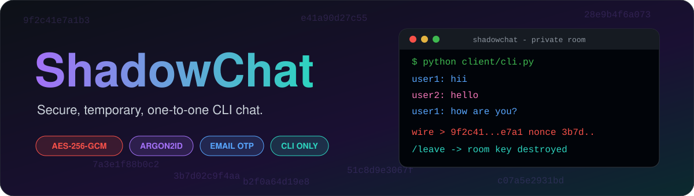

<br/>

# 🔐 ShadowChat: Secure Temporary CLI Chat

> **A command-line-only, temporary, one-to-one encrypted chat system designed for private conversations with OTP verification, authenticated sessions, AES-256-GCM message encryption, and automatic room cleanup.**

<br/>


<br/><br/>


</div>

---

## 📌 Overview

**ShadowChat** is a terminal-based private messaging system built for temporary, one-to-one conversations.

The application uses a **FastAPI + WebSocket server** and a **Python CLI client**. Users register with email verification, authenticate with a User ID and password, find another user, send a private invitation, and enter a temporary two-person room after the invitation is accepted.

Messages are encrypted with **AES-256-GCM on the client side** before being sent through the WebSocket connection. The server acts as a relay and does not keep permanent chat history.

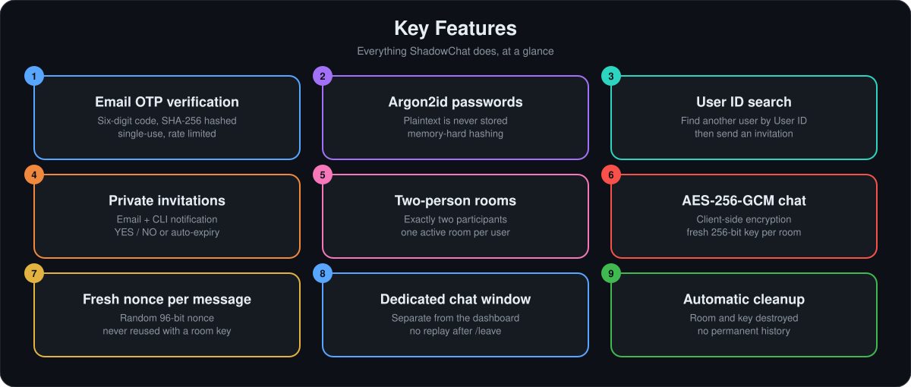

ShadowChat combines:

- 🔐 Secure authentication
- 📧 Email OTP verification
- 👤 User ID based communication
- 🔔 Private chat invitations
- 👥 Exactly two participants per room
- 🔒 Client-side AES-256-GCM encryption
- 🧹 Temporary room and key lifecycle
- 💻 Command-line interaction
- ⚡ REST + WebSocket communication

---

## 🎯 Project Objectives

- Provide temporary one-to-one private communication.
- Verify new users through email OTP.
- Protect user passwords using Argon2id.
- Encrypt message content using AES-256-GCM.
- Prevent permanent storage of chat history.
- Allow only two participants in a private room.
- Allow only one active private room per user.
- Provide invitation-based private communication.
- Destroy room state and encryption keys when a conversation ends.
- Keep the entire application terminal-based without a web frontend.

---

# ✨ Key Features

## 📧 Email OTP Verification

Registration uses a six-digit OTP sent to the user's email address.

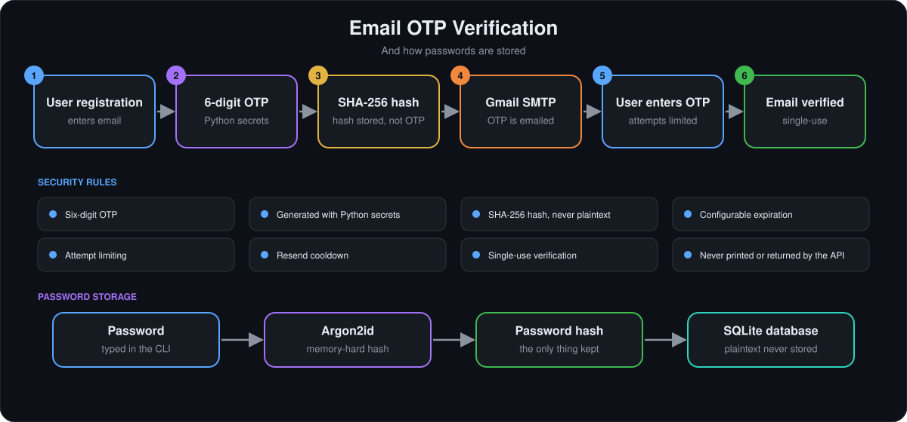

Security rules:

- 🔢 Six-digit OTP
- 🎲 Generated using Python `secrets`
- 🔐 SHA-256 hash stored instead of plaintext OTP
- ⏱️ Configurable expiration
- 🚦 Attempt limiting
- 🔄 Resend cooldown
- ♻️ Single-use verification
- 🚫 OTP is never printed in the terminal or returned by the API

---

## 🔑 Secure Password Authentication

Passwords are hashed using **Argon2id** before storage. Plaintext passwords are never stored. The full storage path (Password → Argon2id → Password Hash → SQLite) is shown at the bottom of the diagram above.

---

## 🔎 User Search

After login, users can search for another user by their **User ID**, then send a private invitation.

---

## 📨 Private Chat Invitations

A user can send a private chat invitation to another registered user.

The recipient receives:

- 📧 An email notification
- 🔔 A notification inside the CLI

The recipient can choose:

```text
YES → Create Private Room
NO  → Reject Invitation
```

Unanswered invitations automatically expire after the configured time.

---

## 👥 Temporary Two-Person Rooms

A private room is created only after an invitation is accepted.

The server enforces:

- Exactly **two participants per room**
- Only **one active room per user**

---

## 🔐 AES-256-GCM Message Encryption

Message content is encrypted before being sent through the WebSocket. The server relays ciphertext only.

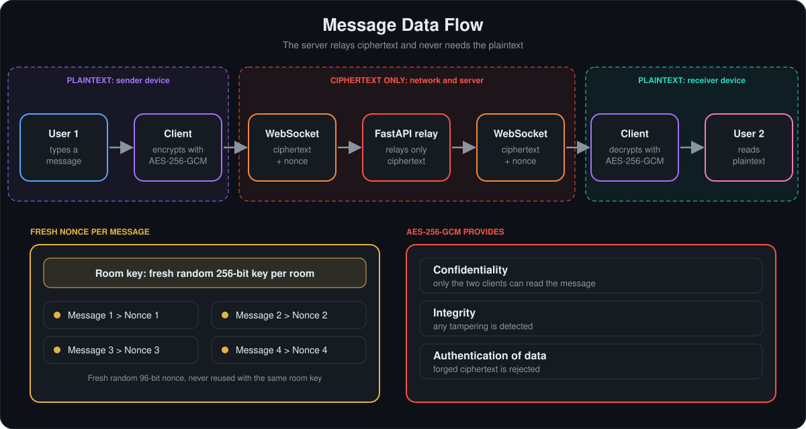

AES-256-GCM provides:

- 🔒 Confidentiality
- 🛡️ Integrity
- ✅ Authentication of encrypted data

Each room receives a fresh random **256-bit session key**.

### 🎲 Fresh Nonce Per Message

Every encrypted message uses a fresh random **96-bit nonce**. A nonce is never reused with the same room key.

---

## 💬 Dedicated Private Chat Interface

Private conversations are kept separate from the main command-line dashboard.

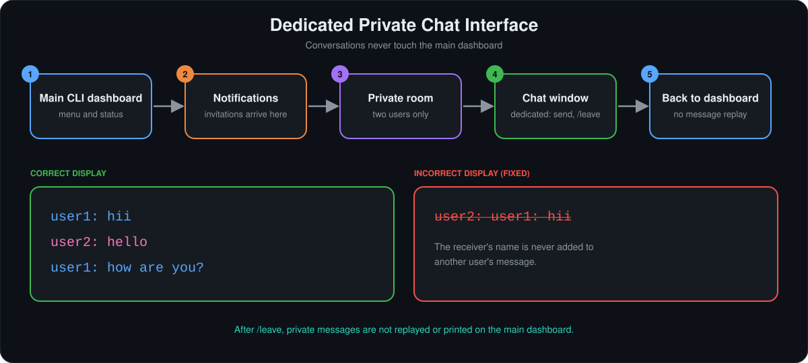

After leaving the room, private messages are **not replayed or printed on the main dashboard**.

The receiver's username is never incorrectly added to another user's message.

---

# 🏗️ System Architecture

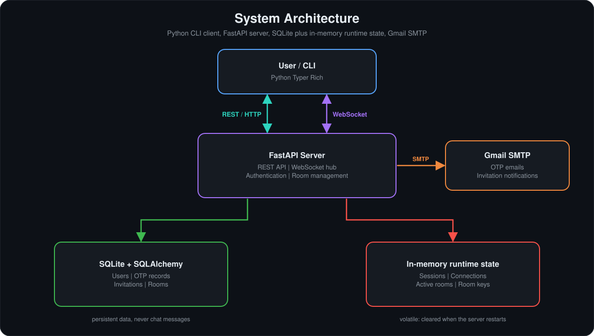

---

# 🔄 Complete Application Workflow

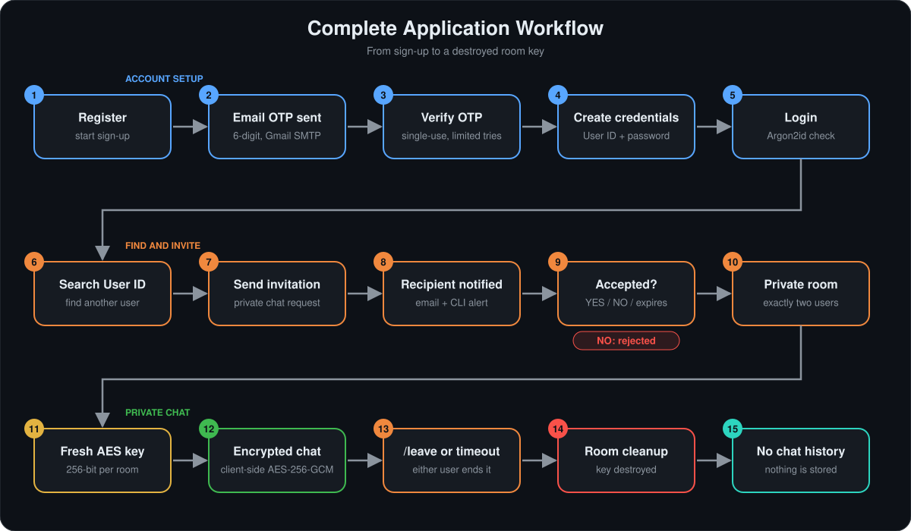

---

# 🧹 Room Lifecycle

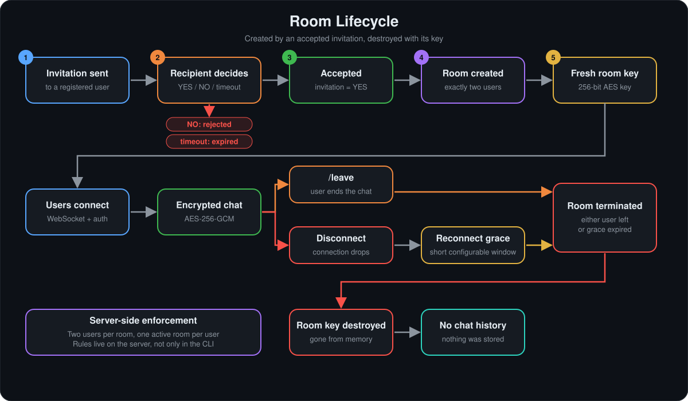

---

# 🛡️ Security Architecture

## 🔐 Authentication Security

| Security Mechanism | Implementation |
|---|---|
| Password Hashing | Argon2id |
| OTP Generation | Python `secrets` |
| OTP Storage | SHA-256 hash |
| OTP Expiration | Configurable |
| OTP Attempts | Configurable |
| OTP Resend | Cooldown protected |
| Session Tokens | Server-side runtime sessions |

## 🔒 Message Security

| Security Mechanism | Implementation |
|---|---|
| Encryption | AES-256-GCM |
| Key Size | 256-bit |
| Room Key | Fresh per room |
| Nonce | Fresh 96-bit nonce per message |
| Chat History | No permanent storage |
| Room Cleanup | Automatic |

### 📊 Security Flow

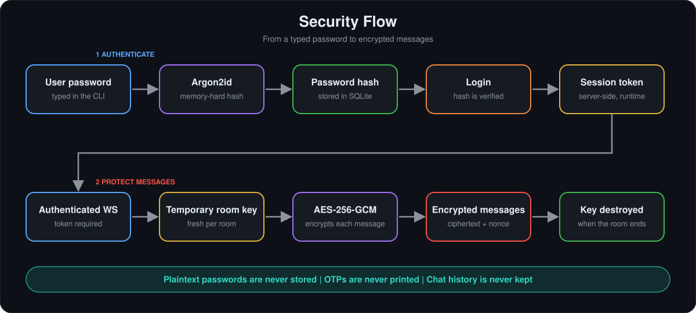

---

# 💻 Software Stack

| Category | Technology |
|---|---|
| Client Language | Python |
| CLI Framework | Typer |
| Terminal UI | Rich |
| Backend Framework | FastAPI |
| Real-Time Communication | WebSockets |
| REST Client | HTTPX |
| ORM | SQLAlchemy |
| Database | SQLite |
| Validation | Pydantic |
| Password Hashing | Argon2id |
| Message Encryption | AES-256-GCM |
| OTP Hashing | SHA-256 |
| Email Service | Gmail SMTP |
| Testing | Python End-to-End Smoke Test |
| Packaging | PyInstaller |
| Version Control | Git |
| Repository | GitHub |

---

# 📂 Project Structure

```text
shadowchat/
│
├── 📁 server/
│   ├── main.py
│   ├── models.py
│   ├── database.py
│   ├── security.py
│   ├── email_utils.py
│   ├── key_manager.py
│   ├── state.py
│   ├── schemas.py
│   └── config.py
│
├── 📁 client/
│   ├── cli.py
│   ├── api.py
│   ├── ws_client.py
│   └── crypto.py
│
├── 📁 assets/              # README banners and diagrams (SVG)
│
├── 📁 venv/
│
├── 📄 .env
├── 📄 .env.example
├── 📄 .gitignore
├── 📄 README.md
├── 📄 requirements.txt
├── 📄 run.py
├── 📄 run_server.py
├── 📄 test_flow.py
├── 📄 ShadowChat.bat
├── 📄 shadowchat_client.sh
└── 🗄️ shadowchat.db
```

> ⚠️ `venv/`, `.env`, `shadowchat.db`, `build/`, and generated distribution files should not be committed to GitHub.

---

# 🚀 Getting Started

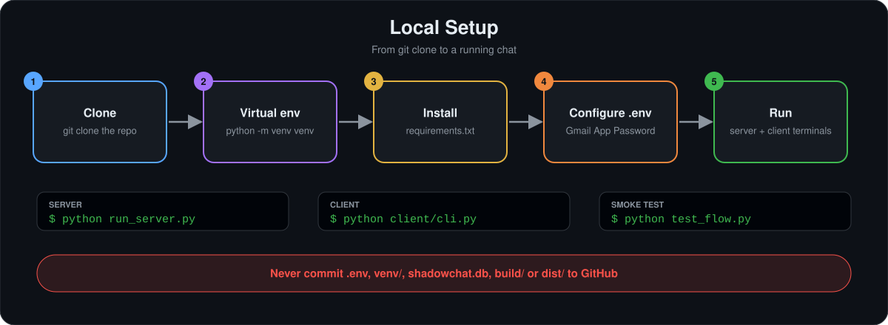

## 1. Clone the Repository

```bash
git clone <YOUR_GITHUB_REPOSITORY_URL>
cd shadowchat
```

## 2. Create a Virtual Environment

### Windows PowerShell

```powershell
py -3.12 -m venv venv
.\venv\Scripts\Activate.ps1
```

### Linux / macOS

```bash
python3 -m venv venv
source venv/bin/activate
```

## 3. Install Dependencies

```bash
pip install -r requirements.txt
```

---

# 📧 Gmail SMTP Configuration

Create a `.env` file in the project root.

```env
SMTP_HOST=smtp.gmail.com
SMTP_PORT=587
SMTP_USERNAME=your-dedicated-gmail@gmail.com
SMTP_APP_PASSWORD=your-16-character-app-password
```

### ⚠️ Important

- Use a dedicated Gmail account for ShadowChat.
- Enable Google 2-Step Verification.
- Create a Gmail App Password.
- Do not use your normal Gmail password.
- Never commit `.env` to GitHub.
- Never place SMTP credentials directly in Python source code.

---

# ⚙️ Environment Configuration

```env
# Server
HOST=127.0.0.1
PORT=8000
DATABASE_URL=sqlite:///./shadowchat.db

# Gmail SMTP
SMTP_HOST=smtp.gmail.com
SMTP_PORT=587
SMTP_USERNAME=your-dedicated-gmail@gmail.com
SMTP_APP_PASSWORD=your-app-password

# OTP / Security
OTP_EXPIRY_MINUTES=5
OTP_MAX_ATTEMPTS=5
OTP_RESEND_COOLDOWN_SECONDS=30
EMAIL_VERIFICATION_TOKEN_TTL_MINUTES=10

# Invitations / Rooms
INVITATION_EXPIRY_MINUTES=5
RECONNECT_GRACE_SECONDS=30

# Client
SERVER_HTTP_URL=http://127.0.0.1:8000
SERVER_WS_URL=ws://127.0.0.1:8000/ws
```

---

# ▶️ Running the Server

### Option 1: Automatic Local Launcher

```bash
python run.py
```

This launcher can start the server and open a client terminal for local development.

### Option 2: Manual Server

```bash
python run_server.py
```

Or:

```bash
uvicorn server.main:app --host 127.0.0.1 --port 8000
```

---

# 💻 Running the Client

Open another terminal and activate the environment.

```powershell
.\venv\Scripts\Activate.ps1
```

Then:

```bash
python client/cli.py
```

The client provides options similar to:

```text
[1] Register
[2] Login
[3] Exit
```

After login, users can search for another User ID, send invitations, respond to notifications, and enter private rooms.

---

# 👥 Testing Two Users

To test a real private conversation, open two terminals:

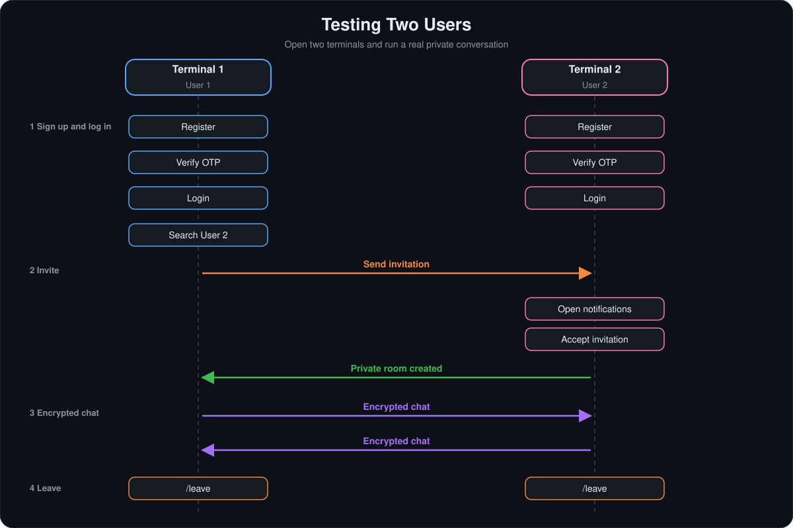

---

# 🧪 Smoke Test

ShadowChat includes an end-to-end smoke test that mocks the SMTP layer, so a real Gmail account is not required for the test.

```bash
python test_flow.py
```

The test covers:

```text
Register → OTP Verification → Login → User Search → Invitation
→ Invitation Acceptance → Temporary Room → Encrypted Chat → Leave → Room Cleanup
```

The test also checks the **one-active-room-per-user** rule.

---

# 📦 Standalone Client

The project can be packaged as a standalone client using PyInstaller.

```bash
pip install pyinstaller
pyinstaller --onefile --name ShadowChat client/cli.py
```

The generated executable will normally be placed in `dist/`.

The project also contains `ShadowChat.bat` and `shadowchat_client.sh` for convenient client launching on supported systems.

---

# 🌍 Production Deployment

For real internet deployment:

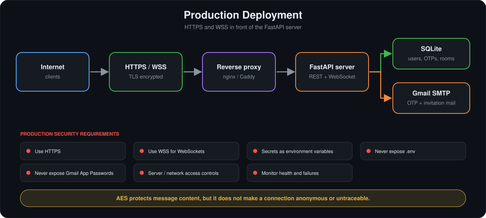

The production client should use:

```env
SERVER_HTTP_URL=https://your-domain.example
SERVER_WS_URL=wss://your-domain.example/ws
```

### Production security requirements

- 🔒 Use HTTPS.
- 🔐 Use WSS for WebSockets.
- 🔑 Store secrets as deployment environment variables.
- 🚫 Never expose `.env`.
- 🚫 Never expose Gmail App Passwords.
- 🛡️ Apply server/network access controls.
- 📊 Monitor server health and failures.

> AES encryption protects message content, but it does not make a connection anonymous or untraceable.

---

# ⚠️ Known Limitations

<details>
<summary><b>1. In-Memory Runtime State</b></summary>

<br/>

Session tokens, active connections, rooms, and room keys are held in server memory. Restarting the server removes active sessions and rooms by design. Users must log in again.

</details>

<details>
<summary><b>2. Server-Mediated Key Exchange</b></summary>

<br/>

The current design is server-mediated: the server hands the room key to both User 1 and User 2.

The `key_manager.py` module is isolated so it can later be replaced with a stronger true end-to-end key exchange architecture. Possible future approaches include X3DH, Double Ratchet, and other modern end-to-end key agreement protocols.

</details>

<details>
<summary><b>3. CLI Rendering</b></summary>

<br/>

The current chat interface uses a threaded input/output approach. An incoming message can occasionally appear while the user is typing. This is a terminal UI limitation and does not change the encryption model.

</details>

---

# 🔮 Future Enhancements

<table>
<tr><td width="50%" valign="top">

### 🔐 Advanced End-to-End Encryption
- X3DH key agreement
- Double Ratchet
- Forward secrecy
- Post-compromise security

### 💻 Advanced Terminal Interface
- Full-screen TUI
- Better message rendering
- Improved asynchronous input
- Message timestamps
- Cleaner notification handling

</td><td width="50%" valign="top">

### ☁️ Deployment
- Docker support
- HTTPS/WSS deployment
- Cloud hosting
- Server monitoring
- Centralized logging for non-message operational events

### 🛡️ Security
- Device authentication
- Multi-device sessions
- Stronger session management
- Rate limiting improvements
- Security audit
- Key rotation mechanisms

</td></tr>
</table>

---

# 🎓 Skills Demonstrated

<table>
<tr><td width="33%" valign="top">

### 🔐 Cybersecurity
- Argon2id password hashing
- AES-256-GCM encryption
- SHA-256 hashing
- OTP security
- Session authentication
- Secure secret management
- WebSocket security concepts

</td><td width="33%" valign="top">

### 🐍 Python Development
- FastAPI
- Typer
- Rich
- HTTPX
- SQLAlchemy
- Pydantic
- WebSockets
- Threaded CLI communication

</td><td width="34%" valign="top">

### 🗄️ Database
- SQLite
- SQLAlchemy ORM
- User management
- OTP records
- Invitation records
- Temporary room records

</td></tr>
<tr><td width="33%" valign="top">

### 🌐 Backend Development
- REST APIs
- WebSocket communication
- Authentication
- Request validation
- Runtime state management
- Room lifecycle management

</td><td width="33%" valign="top">

### 📧 Email Integration
- Gmail SMTP
- OTP delivery
- Invitation notifications
- App Password authentication

</td><td width="34%" valign="top">

### 🧪 Testing & Deployment
- End-to-end testing
- SMTP mocking
- PyInstaller packaging
- Git
- GitHub

</td></tr>
</table>

---

# 📊 Project Status

🚧 **Academic / Security Project**

ShadowChat is a command-line temporary private-chat project focused on learning and demonstrating:

- Secure authentication
- Encrypted communication
- WebSocket applications
- Temporary data lifecycle
- CLI application development
- Cybersecurity concepts

---

# 🧭 Design Principles

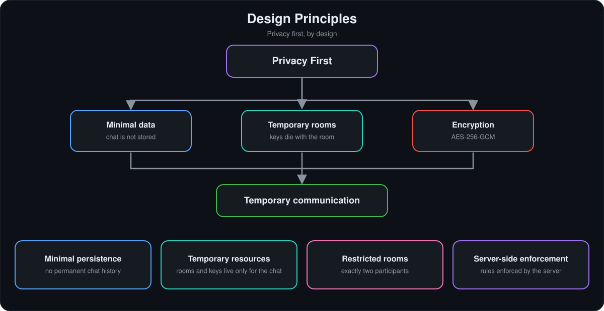

- 🔒 **Minimal Persistence:** chat messages are not maintained as permanent chat history.
- 🧹 **Temporary Resources:** rooms and their keys exist only for the lifetime of the conversation.
- 👥 **Restricted Rooms:** every room contains exactly two participants.
- 🛡️ **Server-Side Enforcement:** important room and participation rules are enforced by the server rather than relying only on the CLI.

---

# 📜 License

This project is developed for **educational and academic purposes**.

---

<div align="center">

# 📫 Contact

**Gunda Tejeswara Rao**

[](https://github.com/gundatejeswararao7)

# ⭐ Support

If you find ShadowChat useful or interesting, consider giving the repository a ⭐ on GitHub.

<br/>


### 🔐 Built with Python + FastAPI + WebSockets + AES-256-GCM

**ShadowChat: Temporary Rooms. Encrypted Messages. Private Communication. 💻**

</div>
